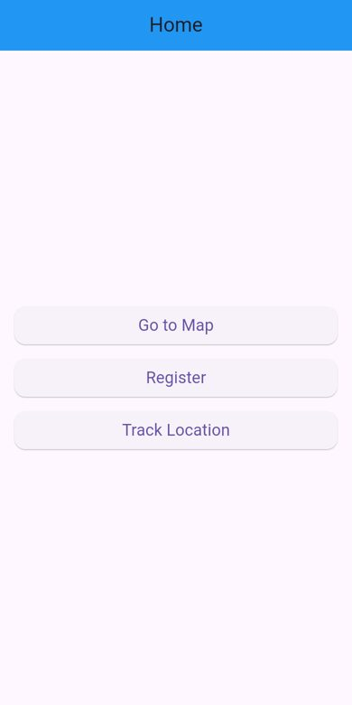

# Mapa Flutter · Rutas y seguimiento de ubicación

App móvil en **Flutter** que muestra la ubicación del usuario en tiempo real y **traza rutas entre dos puntos** con la Google Directions API. Indica la distancia y el tiempo estimado del recorrido.



## Funcionalidades

- **Mapa interactivo:** se marcan origen y destino tocando el mapa, y la app dibuja la ruta con una polilínea.
- Distancia y duración del recorrido. La cámara se ajusta a los límites de la ruta.
- **Seguimiento de ubicación en vivo** con `geolocator`.
- Geocodificación de direcciones.
- Pantallas de inicio, login y registro.

## Stack

Flutter 3 · Dart 3 · google_maps_flutter · Dio · flutter_polyline_points · geolocator · geocoding

## Cómo correrlo

La app necesita una clave de Google Maps con **Maps SDK** y **Directions API** activadas. La clave **no se sube al repo**:

| Plataforma | Dónde poner la clave |
|---|---|
| Dart (Directions API) | `flutter run --dart-define=GOOGLE_MAPS_API_KEY=tu_clave` |
| Android | `android/local.properties` → `MAPS_API_KEY=tu_clave` |
| iOS | `ios/Flutter/Secrets.xcconfig` → `MAPS_API_KEY=tu_clave` |

```bash
flutter pub get
flutter run --dart-define=GOOGLE_MAPS_API_KEY=tu_clave
```

### Calidad

```bash
flutter analyze   # sin issues
flutter test      # pruebas del parser de rutas y de la navegación
```

## Estructura

```
lib/
├── main.dart                     # rutas de la app
├── homepage.dart · loginpage.dart · registerpage.dart
├── mapscreen.dart                # mapa con origen/destino y ruta
├── location_tracking_page.dart   # ubicación en tiempo real
├── directions_respository.dart   # cliente HTTP de la Directions API (Dio)
├── directions_model.dart         # parseo de la respuesta (límites, distancia, polilínea)
└── config.dart                   # clave de la API por --dart-define
```

## Autor

**[Brian Saavedra](https://github.com/briansaa)**
